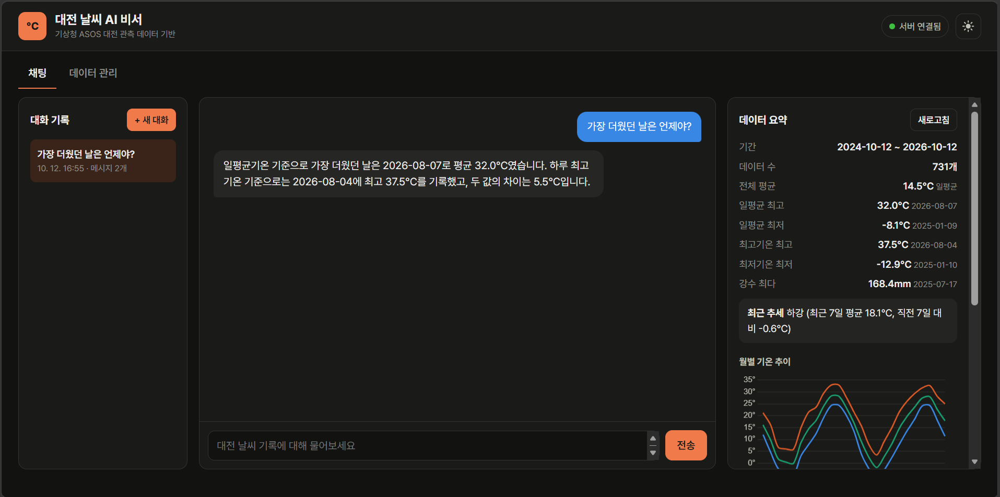
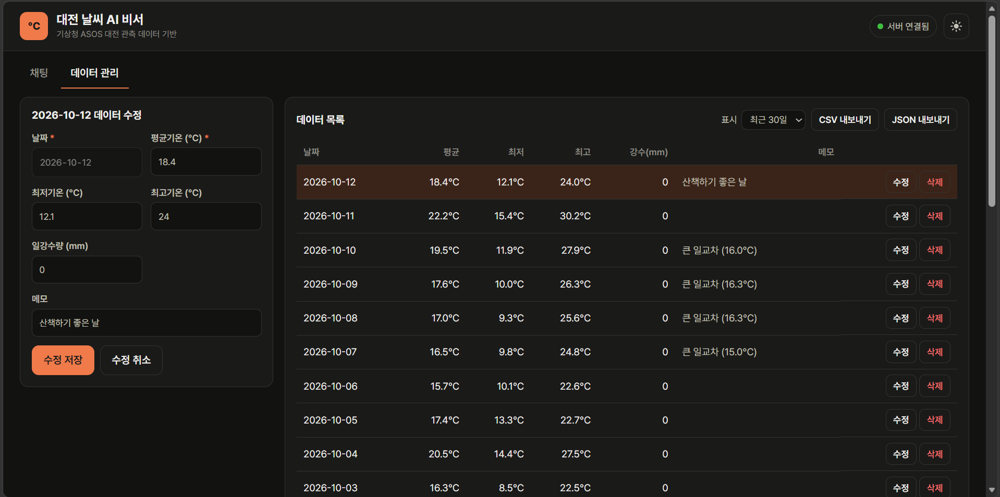
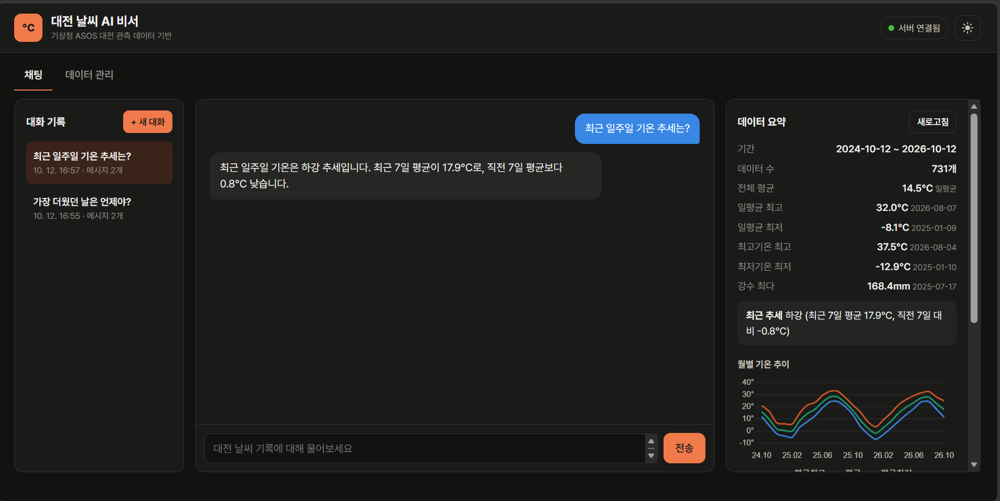
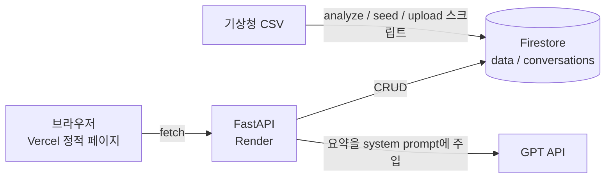

# 대전 날씨 AI 비서

> 내 데이터(대전 2년치 일별 기온)를 이해하고 답하는 AI 챗봇 — 코디세이 M1-2 「AI Agent 개발: 나만의 AI 비서 구축」

일반 챗봇에게 "작년 이맘때보다 추워?"라고 물으면 일반론만 돌아옵니다.
이 서비스는 **기상청 대전 관측소의 2년치 일별 기온 기록**을 데이터베이스에 저장하고, 그 **요약을 시스템 프롬프트에 주입**해서
"가장 더웠던 날", "작년 같은 기간과 비교", "최근 일주일 추세" 같은 질문에 **실제 기록을 근거로** 답합니다.

## 배포 URL

| 구분 | URL |
|---|---|
| 프론트엔드 (Vercel) | https://m1-2-frontend-beta.vercel.app |
| 백엔드 API (Render) | https://m1-2-api-llsn.onrender.com |
| Swagger UI | https://m1-2-api-llsn.onrender.com/docs |

> Render 무료 플랜은 15분간 요청이 없으면 서버가 잠듭니다. 첫 접속은 30초~1분 걸릴 수 있으며, 화면 상단에 "서버 깨우는 중" 안내가 표시됩니다.

## 스크린샷

**1. 데이터 요약이 보이는 채팅 화면** — 질문 + 데이터 기반 답변, 오른쪽에 요약·그래프



**2. 데이터 관리 화면 (CRUD)** — 2026-10-12 데이터 수정 (메모 입력 후 저장)



**3. 대화 기록 화면** — 왼쪽 목록에서 이전 대화를 선택해 메시지 불러오기



## 주요 기능

| 기능 | 내용 |
|---|---|
| 데이터 기반 AI 채팅 | 데이터 요약을 시스템 프롬프트에 주입해 GPT가 실제 기록으로 답변, 로딩 표시 |
| 데이터 관리 (CRUD) | (date, value, memo) + 선택 필드(최저·최고기온, 강수량) 추가/수정/삭제, 목록 |
| 대화 기록 | 채팅 시 자동 저장, 목록 조회, 불러오기, 삭제. 이전 대화 맥락을 이어서 질문 가능 |
| 데이터 요약 | 기간·개수·평균·극값(날짜 포함)·최근 추세 표시 |
| **보너스** 추가 지표 | `/api/data/statistics`: 강수일수, 평균 일교차, 폭염일수, 영하일수, **전년 동기 비교(같은 일수)** |
| **보너스** 시각화 | 월별 평균·평균최고·평균최저 기온 선 그래프 (Chart.js) + 표 보기 |
| **보너스** 내보내기 | 전체 데이터 CSV / JSON 다운로드 (CSV는 엑셀 한글 깨짐 방지 BOM 포함) |
| **보너스** 다크 모드 | 토글 + 선택 기억, OS 설정 자동 반영 |

## 기술 스택

| 영역 | 사용 기술 |
|---|---|
| 백엔드 | Python 3.12, FastAPI, Pydantic v2, Uvicorn |
| 데이터베이스 | Firebase Firestore (`firebase-admin`) |
| AI | OpenAI Python SDK, `gpt-5-mini` (코디세이 OpenAI 호환 중계 서버) |
| 프론트엔드 | HTML / CSS / JavaScript (프레임워크 없음), Chart.js |
| 배포 | Render (백엔드), Vercel (프론트엔드) |
| 데이터 | 기상청 기상자료개방포털 종관기상관측(ASOS) 대전(133) 일자료, 2024-10-12 ~ 2026-10-11 (730일) |

## 구조



### `/api/chat` 동작 흐름 (컨텍스트 주입)

1. 데이터 요약 조회 — `data_service.get_summary()` (HTTP 재호출이 아닌 서비스 함수 직접 호출, 캐시 사용)
2. 요약을 사람이 읽는 문장으로 바꿔 **시스템 프롬프트에 삽입**
3. `conversation_id`가 있으면 Firestore에서 **최근 10개 메시지**를 불러와 함께 전달
4. GPT 호출
5. 질문·답변을 `conversations`에 **자동 저장** (GPT 호출이 성공했을 때만)

<details>
<summary>실제 주입되는 시스템 프롬프트 (요약)</summary>

```
당신은 대전 날씨 데이터 분석 비서입니다. ...
오늘 날짜: 2026-10-12

[사용자 데이터 요약]
- 데이터 기간: 2024-10-12 ~ 2026-10-12
- 총 레코드: 731개 (값: °C (일평균기온))
- 일평균기온 기준: 전체 평균 14.5°C / 가장 높았던 날 32.0°C (2026-08-07) / 가장 낮았던 날 -8.1°C (2025-01-09)
- 하루 중 기온·강수 극값: 최고기온 최고 37.5°C (2026-08-04) / 최저기온 최저 -12.9°C (2025-01-10) / 일강수량 최다 168.4mm (2025-07-17)
- 최근 트렌드: 하강 (최근 7일 평균 17.9°C, 직전 7일 대비 -0.8°C)
- 월별 평균기온 (괄호는 포함 일수): 2024-10: 16.1°C(20일), ..., 2026-10: 17.9°C(12일)
- 전년 동기 비교 (같은 일수): 2026-10 1~12일 평균 17.9°C vs 2025-10 같은 기간 20.8°C (차이 -2.9°C)
- 최근 14일 기록: (날짜별 평균/최저/최고/강수/메모)

[답변 규칙]
1. 위 데이터에 있는 값만 근거로 답하고, 숫자를 지어내지 마세요.
2. 최근 기록에 없는 특정 날짜의 값은 갖고 있지 않습니다. ... 월평균으로 답하세요.
3. 데이터 기간 밖의 일(미래 예보 포함)은 알 수 없다고 말하세요.
4. '평균기온'과 '최고/최저기온'을 구분해서 말하세요. ...
5. 진행 중인 달을 작년 같은 달과 비교할 때는 '전년 동기 비교 (같은 일수)' 값을 사용하세요.
6. 한국어로, 2~4문장 정도로 간결하게 답하세요.
```
</details>

## API

| 메서드 | 경로 | 설명 |
|---|---|---|
| GET | `/` | 상태 확인 (콜드스타트 깨우기용) |
| POST | `/api/data` | 데이터 추가 (같은 날짜가 있으면 409) |
| GET | `/api/data` | 목록 조회 (`start`, `end`, `limit`, `order` 쿼리) |
| PUT | `/api/data/{id}` | 수정 (보낸 필드만, 날짜는 수정 불가) |
| DELETE | `/api/data/{id}` | 삭제 |
| GET | `/api/data/summary` | 데이터 요약 (프롬프트 주입용) |
| GET | `/api/data/statistics` | 추가 지표 + 월별 그래프 데이터 (보너스) |
| POST | `/api/conversations` | 대화 저장 (빈 대화 생성 또는 메시지 직접 저장) |
| GET | `/api/conversations` | 대화 목록 (최근 수정순, **messages 미포함**) |
| GET | `/api/conversations/{id}` | 특정 대화 불러오기 (**전체 messages 포함**) — 요구사항 (A)안 |
| DELETE | `/api/conversations/{id}` | 대화 삭제 |
| POST | `/api/chat` | AI 채팅 (요약 주입 + 자동 저장) |

### Firestore 컬렉션

```
data/{YYYY-MM-DD}            # 문서 ID = 날짜 (하루에 값 하나)
  date, value(일평균기온), memo, min?, max?, rain?

conversations/{자동ID}
  title, created_at, updated_at, message_count,
  messages: [{role: "user" | "assistant", content, created_at}]
```

## 프로젝트 구조

```
M1-2/
├── backend/
│   ├── main.py                    # 앱 진입점: CORS, 예외→HTTP 상태 변환, 라우터 등록
│   ├── app/
│   │   ├── core/                  # config(환경변수), firebase(클라이언트), errors(도메인 예외)
│   │   ├── schemas/               # Pydantic 요청/응답 모델 + 검증 규칙
│   │   ├── routers/               # data, conversations, chat — HTTP 입출력만 담당
│   │   └── services/              # 비즈니스 로직: analysis(요약·통계), data, conversation, chat
│   ├── scripts/
│   │   ├── upload_seed.py         # seed.json → Firestore 업로드
│   │   └── check_llm.py           # AI 연결·옵션 지원 여부·답변 품질 점검
│   ├── requirements.txt
│   ├── .python-version            # Render Python 버전 (3.12)
│   └── .env.example
├── frontend/
│   ├── index.html, style.css
│   ├── api.js                     # 백엔드 호출 모음
│   ├── app.js                     # 화면 동작
│   ├── build-config.js            # Vercel 빌드 시 환경변수 → config.js 생성
│   └── vercel.json
├── data/
│   ├── OBS_ASOS_DD_*.csv          # 기상청 원본 (CP949)
│   ├── analyze.py                 # CSV 분석 → summary_sample.json
│   └── prepare_seed.py            # CSV → seed.json (memo 자동 생성)
└── docs/                          # 스크린샷
```

## 로컬 실행

### 1. 백엔드

```bash
cd backend
python -m venv venv
# Windows: .\venv\Scripts\Activate.ps1   /   macOS·Linux: source venv/bin/activate
pip install -r requirements.txt
cp .env.example .env               # 값 채우기 (아래 환경 변수 참고)
uvicorn main:app --reload          # http://127.0.0.1:8000/docs
```

처음 한 번 데이터 준비:

```bash
cd data && python prepare_seed.py              # CSV → seed.json
cd ../backend && python -m scripts.upload_seed # Firestore 업로드 (문서 ID=날짜라 재실행해도 중복 없음)
python -m scripts.check_llm                    # (선택) AI 연결·답변 확인
```

### 2. 프론트엔드

`frontend/index.html`을 VS Code **Live Server**(포트 5500)로 엽니다.
`config.js`가 없으면 `http://127.0.0.1:8000`(로컬 백엔드)을 기본으로 사용합니다.

## 환경 변수

### 백엔드 (`backend/.env`, Render Environment)

| 이름 | 필수 | 설명 |
|---|---|---|
| `OPENAI_API_KEY` | O | API 키 |
| `OPENAI_BASE_URL` | △ | 중계 서버 주소 (코디세이: `https://copa.codyssey.kr/v1`). 공식 OpenAI 키면 비움 |
| `OPENAI_MODEL` | | 기본 `gpt-5-mini` |
| `FIREBASE_SERVICE_ACCOUNT_PATH` | △ | 로컬: 서비스 계정 키 파일 경로 |
| `FIREBASE_SERVICE_ACCOUNT_JSON` | △ | 배포: 서비스 계정 키 JSON 전체 문자열 (PATH와 둘 중 하나) |
| `ALLOWED_ORIGINS` | O | CORS 허용 도메인, 쉼표 구분 (예: `https://m1-2-frontend-beta.vercel.app,http://127.0.0.1:5500`) |
| `OPENAI_MAX_TOKENS` | | 출력 토큰 상한, 기본 1500 |
| `OPENAI_REASONING_EFFORT` | | 추론 강도. 코디세이 서버는 미지원이라 기본 비움 |
| `CHAT_HISTORY_LIMIT` | | GPT에 보낼 이전 메시지 수, 기본 10 |

### 프론트엔드 (Vercel Environment)

| 이름 | 설명 |
|---|---|
| `API_BASE_URL` | 백엔드 주소. 빌드 시 `build-config.js`가 `config.js`로 만들어 배포 |

## 배포 설정

**Render (백엔드)** — Root Directory `backend` / Build `pip install -r requirements.txt` / Start `uvicorn main:app --host 0.0.0.0 --port $PORT` / Region Singapore

**Vercel (프론트엔드)** — Root Directory `frontend` / Framework Other / 빌드 설정은 `vercel.json` (`node build-config.js`) / 환경 변수 `API_BASE_URL`

## 설계 포인트

### 1. 시계열 분석 → 요약 → 서비스 활용
- 원본 CSV를 `analyze.py`로 점검(730일, 결측 없음, 강수 빈칸=무강수)하고, 같은 요약 함수(`services/analysis.py`)를 **로컬 분석과 백엔드가 공유**합니다.
- 기온은 계절성이 강해 2년 전체의 상승/하강은 의미가 없으므로, 추세는 **최근 7일 vs 직전 7일**로 판단합니다.
- 요약에는 평균·최대·최소뿐 아니라 **날짜**, **월별 평균(+일수)**, **최근 14일 원본**을 넣었습니다. 숫자만 주면 "가장 더웠던 날은?"에 AI가 날짜를 지어내기 때문입니다.
- 요약은 CSV가 아니라 **Firestore 현재 데이터로 매번 계산**하므로, 화면에서 데이터를 고치면 AI 답변에도 바로 반영됩니다.

### 2. 라우터 / 서비스 / 스키마 분리
- **라우터**는 HTTP 입출력만, **서비스**는 비즈니스 규칙만, **스키마**는 검증만 담당합니다.
- 서비스는 HTTP를 모르고 `NotFoundError`, `ConflictError` 같은 도메인 예외만 던지며, `main.py`가 이를 404/409/422/502/503으로 변환합니다.

### 3. Pydantic 검증
- 기온 범위(-50~50°C), 강수량(0 이상), 메모 길이, 미래 날짜 금지, **최저 ≤ 평균 ≤ 최고** 관계를 요청 단계에서 422로 차단합니다.
- 수정(PUT)은 보낸 필드만 반영하되, **기존 값과 합친 뒤 다시 검증**합니다 (예: value만 30으로 바꿨는데 기존 max가 24인 경우).
- 날짜는 문서 ID(데이터의 정체성)이므로 수정 요청에 포함하면 422 (`extra="forbid"`).

### 4. Firestore 설계
- `data`는 **날짜를 문서 ID**로 사용해 중복을 원천 차단하고(`create()`는 이미 있으면 실패), 시드 업로드를 여러 번 해도 덮어쓰기만 됩니다.
- `conversations`는 대화 하나 = 문서 하나(messages 배열)로, 불러오기를 1회 읽기로 끝냅니다. 목록 조회는 `select()`로 messages를 읽지 않습니다.
- 요약·통계는 전체 문서(730건+)가 필요하므로 **메모리 캐시**(쓰기 시 무효화 + 10분 TTL)를 둡니다. 캐시가 없으면 채팅 1회마다 730건을 읽어 무료 한도(일 5만 건)가 약 68회 대화로 소진됩니다.

### 5. 컨텍스트 주입에서 발견하고 고친 문제
- **기준 혼동**: 요약에 "최고 32.0°C"라고만 넣었더니 AI가 일평균기온을 "최고기온"이라고 답했습니다 (실제 최고기온 최고는 37.5°C). → 요약을 **일평균 기준(metrics)과 최고/최저기온 기준(extremes)**으로 분리하고, 모호한 질문엔 두 기준을 함께 답하도록 규칙을 추가했습니다.
- **일수가 다른 비교**: "이번 달 vs 작년 10월"에 AI가 이번 달 12일치(17.9°C)와 작년 31일 전체(16.9°C)를 비교해 "1.0°C 높다"고 답했습니다. 같은 1~12일끼리 비교하면 작년이 20.8°C라 **2.9°C 낮습니다**(10월은 하순으로 갈수록 추워져 월 전체 평균이 낮게 나옴). → 통계 API에 **같은 일수 비교**를 추가하고 프롬프트에도 주입했습니다.
- **모르는 값은 모른다고**: 최근 14일 밖의 특정 날짜는 월평균만 안다고 밝히고, 미래 예보는 거절하도록 규칙을 두었습니다.

### 6. 배포 환경: CORS / 환경 변수 / 키 관리
- 모든 키는 코드에 없고 `.env`(로컬, `.gitignore` 처리) 또는 Render 환경 변수에만 있습니다. Firebase 키는 로컬은 파일 경로, 배포는 JSON 문자열로 같은 코드가 읽습니다.
- 프론트(Vercel)와 백엔드(Render)는 출처가 달라 브라우저가 요청을 막으므로, `ALLOWED_ORIGINS`로 **허용할 도메인만** 명시합니다.
- 정적 페이지는 실행 시점에 환경 변수를 읽을 수 없으므로, **빌드 시점에 `config.js`를 생성**하는 방식으로 "환경 변수로 API 주소 설정"을 구현했습니다.

### 비용 관리
- 출력 토큰 상한 1500(추론 모델은 '생각' 토큰 포함), 질문 1000자 제한, 이전 대화는 최근 10개만 전송.
- `gpt-5-mini`(코디세이 차감 0.5배). 측정 결과 질문당 입력 약 1,300 / 출력 300~700 토큰, 응답 2.5~5초.
- 코디세이 중계 서버는 `reasoning_effort`를 지원하지 않아(400 `unsupported_feature`), `scripts/check_llm.py --probe`로 지원 옵션을 확인해 설정을 맞췄습니다.

## 한계와 개선 방향

- **오래된 특정 날짜의 상세 값**(예: "2025년 3월 5일 강수량")은 요약에 없어 답할 수 없습니다. 요약을 무한히 늘릴 수 없으므로, GPT가 필요할 때 데이터 조회 API를 직접 호출하는 **Function Calling**이 근본적인 해결책입니다.
- **인증이 없습니다.** 배포 URL을 아는 누구나 데이터를 수정·삭제할 수 있습니다. 실제 서비스라면 Firebase Auth 등으로 쓰기 권한을 제한해야 합니다.
- 캐시가 서버 메모리에 있어, 인스턴스가 여러 개로 늘어나면 인스턴스 간 캐시가 맞지 않을 수 있습니다 (현재 무료 플랜은 단일 인스턴스).
- Render 무료 플랜의 콜드스타트(최대 1분)는 안내 문구로 대응했으며, 근본 해결은 유료 플랜 또는 주기적 헬스체크입니다.
